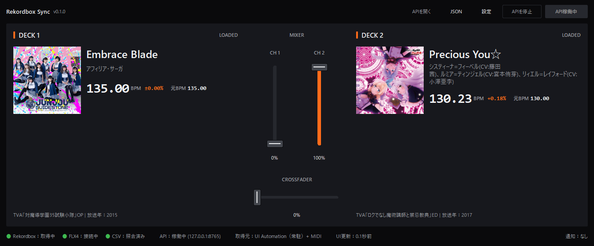

# Rekordbox Sync

[](https://github.com/NobuTama31/rekordbox-sync/actions/workflows/tests.yml)

Windows / Rekordbox 7 / DDJ-FLX4 の「今かかっている曲とフェーダー」を読み取る、Python ライブラリとローカル HTTP API です。

Rekordbox には再生状態を外から取る公開 API がありません。そこで曲情報は **UI Automation**、物理フェーダーは **MIDI** で取得し、HTTP API として公開します。デスクトップ GUI と OBS オーバーレイ（HTML）は、その API の利用者です。



## 全体像

```
Rekordbox ── UI Automation ──┐
DDJ-FLX4 ─── MIDI ───────────┤
                             ├─→ Monitor / StateStore ─→ HTTP API ─→ デスクトップ GUI
CSV / iTunes ─ enrichment ───┘                            └─→ OBS オーバーレイ (HTML)
```

## コンポーネント

### UI Automation（曲情報）

- `capture.ps1` が Rekordbox の UI Automation ツリーを歩き、Python のデコーダが「BEAT SYNC」ボタン等のアンカーと画面上の幾何関係だけで曲名・アーティスト・BPM・再生位置を解読します。ランタイム ID やツリーの並び順には依存しません
- **常駐版（追跡読み）が既定**です。全体走査で特定した約95要素だけを毎回読み直し、要素が stale になった／安定テキストが変わった／60秒の再同期、のいずれかで全体走査に戻ります。[設計](docs/resident_uia.md)
- UI の列挙は原子的ではなく、忙しい Rekordbox では木が部分的に欠けて返ることがあります。欠けた取得は「情報なし」として扱い、品質判定（ロード済みデッキの現在 BPM が無い取得は疑わしい）と再取得で吸収します

### MIDI（フェーダー）

- DDJ-FLX4 のコントロールチェンジをコールバックで受け、MSB/LSB のペアを 14bit 値にデコードします（チャンネルフェーダー×2、クロスフェーダー）
- 値は物理コントロールの位置です。Rekordbox 側の実効値とは異なる場合があります

### 状態管理（Monitor / StateStore）

- UI Automation と MIDI の2本のポーリングが、不変の観測（observation）を StateStore に集約し、スナップショットとして配ります
- 鮮度は取得元ごとに管理します。UIA は6秒で失効し、失敗時は最後の正常なデッキを保持してエラーを併記します。MIDI は接続中は最後の値を保持し、切断で無効化します
- **分からない値は `None` です。** 再生の推測で PLAY / MASTER / ON AIR を埋めることはしません（常に `null`）

### HTTP API

- `127.0.0.1:8765`、schema version 1。[API 仕様](docs/api.md)
  - `/state` — ライブ状態、`/health` — 取得元の状態
  - `/state/enriched` — CSV と外部カタログの楽曲情報を付加した状態
  - `/song-info?title=...&artist=...` — 指定曲の CSV 情報
  - `/nowplaying.json` — オーバーレイ向けの「今の曲」（ETag / 304 対応）
  - `/overlay`、`/overlay.css`、`/overlay.js` — OBS オーバーレイ本体

### デスクトップ GUI

- CustomTkinter 製のセッションモニターです。API クライアントであり、自分ではキャプチャしません
- API を内蔵起動もできます。その場合も、**自分が起動した API だけを停止**し、既存の API には接続するだけです。[GUI 仕様](docs/gui.md)

### OBS オーバーレイ

- API が配信する HTML / CSS / JS です。OBS のブラウザソースで `http://127.0.0.1:8765/overlay`（1920×1080）を開くと、今の曲のカード（ジャケット、曲名、アーティスト、作品名、放送年）を表示します
- 表示デッキは「最後に曲が変わった方」を基本に、チャンネルフェーダーが大きい方を優先します。アートワークの取得に失敗しても、ポーリングのたびに指数バックオフで再試行します

### 楽曲メタデータ

- `song_catalog` — CSV（タイトル＋歌手）を読み取り専用で検索する独立パッケージ。監視や Windows が無くても使えます。同名同歌手が複数あれば黙って選ばず `ambiguous` を返します。[仕様](docs/song_catalog.md)
- `track_metadata` — iTunes Search の結果をバックグラウンドで取得し、SQLite に永続化します。HTTP のリクエスト処理中には検索しません。照合は正規化した完全一致系のみで、部分一致による誤判定をしません。[仕様](docs/track_metadata.md)

## セットアップと起動

```powershell
py -m venv .venv
.\.venv\Scripts\python.exe -m pip install -e ".[gui]"
```

API のみ（CSV の付加情報つき）:

```powershell
.\.venv\Scripts\python.exe -m rekordbox_sync serve --catalog assets/song_info.csv
```

GUI（API が無ければ内蔵起動）:

```powershell
.\.venv\Scripts\python.exe -m rekordbox_sync gui --catalog assets/song_info.csv --start-api
```

`scripts/start_gui.cmd` のダブルクリックでも起動できます。CSV 不要なら `--catalog` を省略できます。Ctrl+C で停止します。

## ライブラリとして使う

```python
from rekordbox_sync import MonitorConfig, RekordboxMonitor
from song_catalog import CsvSongCatalog

catalog = CsvSongCatalog("assets/song_info.csv")
result = catalog.lookup("いつかの、いくつかのきみとのせかい", "fhána", fields=["TVA"])
print(result.to_dict())

with RekordboxMonitor(MonitorConfig()) as monitor:
    snapshot = monitor.snapshot()
```

監視は非同期で、開始直後の snapshot はまだ空の場合があります。
[継続読み取り例](examples/use_library.py) / [HTTP 利用例](examples/read_http.py)

## 制約

- 実機確認は横並び2デッキ画面です。最小化中でも取得できることを確認済みです
- UI 取得は秒単位のポーリングです。読み取りは同時ではないため、曲の交換直後に混在が残る場合があります
- 物理フェーダーは、接続後に動かすまで値が不明です
- PLAY / MASTER / ON AIR は未対応で `null` です。WebSocket も未実装です
- 再生位置は API にはありますが、取得間隔が粗いため GUI には表示しません

## 開発

```powershell
.\.venv\Scripts\python.exe -m unittest discover -s tests
.\.venv\Scripts\python.exe -m ruff check src tests
.\.venv\Scripts\python.exe -m ruff format --check src tests
```

テスト（152件、うち Windows 専用は PowerShell プロトコルの実走テスト）は GitHub Actions で Windows / Ubuntu の両方で自動実行されます。lint と整形の規則は `pyproject.toml` に固定しています。Python 3.10 以降が対象です。

検証用に `probe`（MIDI / OSC の読み取り専用キャプチャ、OSC は `.[probe]` の追加依存）、`capture-uia`（UI スナップショットの記録）、`extract`（記録したスナップショットのオフライン解読）もあります。通常の監視ではスナップショットを保存しません。

実装前に [AGENTS.md](AGENTS.md)、[設計方針](docs/architecture.md)、[命名規則](docs/naming.md) を参照してください。
[検証履歴](docs/validation.md) / [当初の計画](docs/implementation_plan.md)

- `src/rekordbox_sync/` — 監視、状態管理、HTTP API、GUI、CLI
- `src/song_catalog/` — 独立した CSV 楽曲情報検索
- `src/track_metadata/` — 外部カタログ取得と照合、SQLite ストア
- `tests/fixtures/` — 実機データによる回帰テスト
- `docs/` — 設計、命名、API 仕様、検証記録
- `assets/` — 外部管理の入力 CSV（wheel へ同梱しません）
